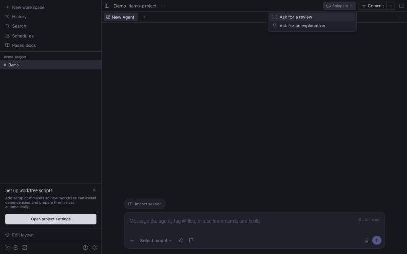

# morphise

## Quick Chat

Quick Chat is an opt-in Morphise feature for chatting and capturing ideas without choosing a project. Open it from the sidebar or Command Center, enable it, and choose a model beside New Quick Chat. The picker shows Paseo's native artwork for built-in providers, or host-supplied artwork for custom providers, directly beside the model name, with full provider identity in accessibility and hover/focus help. Duplicate model names receive a small provider-identity badge; missing icons use a neutral CPU icon. The new chat opens in Paseo's native UI. Search your existing chats by title, open one, or choose Continue in project. Stored titles wrap fully; compact rows place actions below the title. Chat info shows the full stored title, provider, archive state, UTC creation/update/archive timestamps, chat/workspace identifiers and storage locations. Missing metadata is marked Unavailable; no transcript is read for these details. Existing titles are never bulk-rewritten. Open Plugins → Morphise → Settings → Quick Chat for enable/disable, start-up, appearance and storage/privacy controls. The Quick Chat header has no redundant Settings shortcut. Active/Archived counts replace a separate chat-list heading. Refresh is right-aligned on the list filter/sort toolbar; it manually reloads the list, which is not live-subscribed. Recover handoff remains a separate chat-screen action. The last successfully used provider/model is remembered on this device by default and preloaded next time, without substituting unavailable models. Device preferences let you turn memory off, forget the saved model, choose Comfortable/Wide content, Compact/Comfortable rows and row descriptions. Reset appearance leaves model history and host availability unchanged. Each Quick Chat workspace has separate scratch storage; native tabs inside that workspace share the folder. Scratch storage is not a security sandbox.

Continue in project prepares an editable preview of visible messages for an already-open project workspace. It shows destination/provider, partial-history warnings and top-level scratch filenames. Confirming creates a new agent with ordinary project permission defaults. It does not move the original session, copy files, include reasoning/tool output/attachments, archive the source or silently switch providers. The handoff is a reviewed snapshot, not an atomic freeze: concurrent changes after the final source check are not included. Context is bounded to 40,000 UTF-16 code units including the envelope, with truncation disclosed; history reading is bounded and may be partial. Reading native history may initialize a stopped provider for history access.

Recovery records cover a completed disk write followed by a plugin/process restart; power-loss durability is not guaranteed. An interrupted creation is never automatically resent. Keep the displayed recovery ID and use Check recovery ID to look up the recorded destination. If the destination cannot be confirmed, inspect Paseo before preparing a new handoff. Disabling Quick Chat preserves chats, scratch files and minimal handoff records. Scratch and recovery data live under `PASEO_HOME/plugin-data/morphise/quick-chat` (default `~/.paseo`). No transcript bodies are stored in recovery records. There is no automatic cleanup or retention expiry; remove data manually only after preserving anything needed.

### Feature inspiration

Quick Chat lists Active and Archived conversations separately. Search titles, filter by provider, and sort by recently updated, newest created or title. Click a chat title to open it. Row icons provide file-location information, Continue in project for active chats, and Archive or Unarchive; each has an accessible name and hover tooltip.

Archive requires confirmation: it closes the agent, stops its work and Morphise commands, and removes saved command-output logs through Morphise's existing archive policy. The conversation and scratch files remain. Unarchive restores the same native agent and may initialize its provider, but does not restore removed logs or send a new prompt from Morphise. It does not archive/delete the workspace. Restore stays available for owned chats when new Quick Chats are disabled. List updates remain manual through Refresh.

New Quick Chats leave their agent title unset so Paseo applies the same first-message automatic title as normal chats. Morphise does not run a separate title model or rename existing chats. Previously created chats explicitly titled Quick Chat are not rewritten; rename those normally if needed. The workspace may retain its Quick Chat organizational label even when its agent tab has a descriptive title.

Use **Files location** on a chat row to see its exact working folder and where a relative `docs/` path resolves on the daemon host. A displayed path is not confirmation that the directory/report exists. New-chat instructions include these absolute paths and ask the agent to distinguish planned saves from completed writes; an agent response is still not a filesystem guarantee. Existing chat instructions are not retroactively changed. Scratch files remain in that folder when you continue in a project.

Morphise's Quick Chat was independently implemented. The project-free chat and later project-handoff workflow was inspired by [Quick Chat by Shuvadipta Das (@5h0ov)](https://github.com/5h0ov/paseo-quick-chat), whose source is MIT-licensed. No code, assets, tests or prompt templates from that plugin are included. Existing Morphise third-party notices remain in `NOTICE.md`.


A [Paseo](https://paseo.sh) plugin that reshapes the app from settings forms: named layouts, a status-sorted and filterable sidebar view, a kanban task board with reminders, chat notes, a prompt library, theme, sidebar rows, workspace header buttons, composer pills and controls, slash commands, Command Center items, New workspace presets, hidden timeline rows, and an opt-in desktop style layer. Change it under Settings, Plugins, Morphise; every connected app updates live.



What each section does and its limits: [OVERVIEW.md](OVERVIEW.md).

## Install

Requires Paseo 0.16.0-beta.1 or later.

```bash
paseo plugin install github:monarchmaisuriya/morphise --ref v0.23.0
```

To update from an earlier version, keeping your settings:

```bash
paseo plugin update morphise --ref v0.23.0
```

## Credits and licences

Morphise includes code ported from seven MIT-licensed Paseo plugins. Each ported file names its source in its first comment, and [NOTICE.md](NOTICE.md) holds each licence in full.

Quick Chat is separately credited above as feature inspiration, not as an eighth code port. Its independent implementation, UI refinements and device preferences add no third-party dependency. See [NOTICE.md](NOTICE.md#feature-inspiration-not-incorporated-code) for that distinction.

| Plugin | Author | What Morphise uses | Licence |
| --- | --- | --- | --- |
| [Chat Polish](https://github.com/lthieu96/paseo-chat-polish) | Hieu Le | Chat rows, merged steps, pictures, HTML pages, diagrams, the optional restyle of Paseo's own items | MIT |
| [Shell Yeah](https://github.com/stevecastaneda/paseo-plugins/tree/main/shell-yeah) | Steve Castaneda | The command runner behind `/run` and the Run buttons, and its output cards | MIT |
| [Quote](https://github.com/keefeere/paseo-quote) | Chechulin Serhii | The bar over selected text in a chat | MIT |
| [Better Paseo](https://github.com/RoundRedDot/better-paseo) | ABorakati | The Agents view, generated titles (the approach) and the matching rules of conversation search | MIT |
| [Project Groups](https://github.com/topar12/paseo-project-groups) | topar12 | "Your groups": the groups model, colours and icons, Remove project | MIT |
| [Harness Stats](https://github.com/kogekiplay/paseo-harness-stats) | kogekiplay | Session stats: the log reader and fold, the pills and the strip (with CC Switch's time-to-first-token approach) | MIT |
| [Activity](https://github.com/koinzhang/paseo-plugins/tree/main/activity) | koinzhang | The Activity tab (metrics, rankings, insights, terminals) and the Tools counts in Stats: the counting rules, read from logs instead of timelines | MIT |

Packages Morphise installs on the daemon when their option is used: [pele](https://www.npmjs.com/package/pele) (diagrams, MIT) and [sharp](https://sharp.pixelplumbing.com) (thumbnails, Apache-2.0; its prebuilt libvips is LGPL-3.0-or-later). The optional icon sets are downloaded from npm when picked: Hugeicons (MIT) and Untitled UI (its own licence). Commands that run in a terminal use the `node-pty` that Paseo itself ships (MIT); Morphise does not include a copy.

## Develop

```bash
npm install
npm run typecheck
npm test
```

Versions follow [semantic versioning](https://semver.org): `package.json` holds the version, each release is tagged `vX.Y.Z`, and [CHANGELOG.md](CHANGELOG.md) lists the changes.

### Sidebar status indicators

In Plugins → Morphise → Settings → Look → Sidebar status indicators, choose **Dot and ring** (default) or **Paseo default**. Both Paseo’s native sidebar and Morphise’s replacement sidebar use the same standalone shape, with no provider logo and no pulsing. Starting, Working, Needs input, Failed, Attention/unread and Idle/done each have a color override (`#RRGGBB`, blank follows the semantic theme default) and rotation speed: Stopped, Slow (3.2 seconds), Medium (1.6 seconds), Fast (0.8 seconds per revolution). Preview every state beside its controls. Reduced motion stops all plugin rotation.

These are profile settings, independent of Restyle Paseo, on desktop/web only. Switching to Paseo default preserves custom choices; Reset sidebar indicators restores recommended values without changing other settings. Invalid partial color text stays local and does not replace saved preferences. Existing host indicators remain intact under the presentation override, so choosing Paseo default or unloading Morphise restores them; host-owned hidden animation clocks may continue. Unknown/absent host status slots are not invented or relabeled.

Morphise’s main sidebar marks are 14px at full opacity; nested chat and subagent marks are 12px at 80% opacity, with identical state colors and rotation speeds. The old Chat row marks selector is removed; legacy saved values remain readable but no longer select dashed circles or separate dots. The replacement sidebar subscribes to the same profile preferences, including after profile hydration and when Settings is closed. On native phones the plugin retains a static dot fallback.

#### Indicator size and alignment

The same Look section includes **Main indicator size** (10–24px, default 14px) and **Indicator vertical alignment** (Top, Center or Bottom; default Center). Alignment uses the full row content, including two-line rows. Nested chats and subagents always derive exactly 80% of the main size and 80% of main opacity; there are no independent nested controls. At the default, nested size is 11.2px. Layout reset restores 14px/Center without changing colors or speeds. The full sidebar-indicator reset restores layout and state appearance together. Layout is saved separately so older readers preserve it without invalidating existing color/speed settings. Paseo default leaves native host appearance unchanged.

### Workspace checkpoints

Open a workspace's **Checkpoint** panel for Goal, Last verified result, Blocked by and Next step. Save is explicit. The card shows its revision, author and timestamp; a conflicting save is rejected without discarding your draft. Reload latest explicitly replaces that draft. This is a user/agent-authored status record, not proof that work was completed and not an automatic summary. Each field is limited to 2,000 characters.

Interactive top-level agents receive a `workspace_checkpoint` tool when their provider session opens. It reads or updates only that agent's verified own workspace; updates require the revision returned by a read. Subagents and background helpers cannot write shared checkpoint cards. Existing sessions may need to reopen to receive the tool. Other workspace Notes and titles are untouched.

### Agent work calendar

**Workbench → Calendar** offers Day/Week, date navigation, provider/workspace/project filtering and links back to chats. Times display in the viewing device's timezone. It records turn-start/end observations from when this plugin version begins observing; there is **no historical backfill** and no claim that an observation covers periods when the plugin was not running. Refresh updates the snapshot; running duration is as of that refresh.

Summed agent time includes each parallel agent separately; elapsed coverage merges overlapping intervals. Neither is human labor time or a bill. Null-ID, interrupted, overlapping/restarted observations are labelled uncertain and excluded from totals. A plugin restart cannot credit downtime: unfinished intervals become uncertain at their last recorded observation. Hidden background helpers are excluded when the host reports them; older hosts may not expose every helper flag. Terminal history older than 90 days is hidden and pruned on the next recorded event; storage caps at 20,000 intervals, preserving active records. The view discloses recording start and pruning. Agent-turn wall time can include waits for tools or user input; it is not pure CPU/model time.

Checkpoints and intervals live on the daemon in `$PASEO_HOME/plugin-data/morphise/work/records.json` (default `~/.paseo`). The store validates records, serializes one plugin process's operations, writes an atomic replacement and publishes memory only after persistence succeeds. Corrupt storage reports an error rather than overwriting it. It is not a secret store, encrypted vault or multiprocess database; only checkpoint text and visible short agent titles/IDs/timestamps are retained, not transcripts or credentials.

### Quota-aware Dispatch

Every Dispatch start/retry/keyboard launch checks the host's provider-reported quota, with a five-second timeout. Fresh, exact-provider percentage windows at **80% used or higher** show a warning and require **Continue anyway**. A reported 100% is labelled exhausted. The confirmation covers the exact model, source/project parameters and prompt batch, expires after at most a minute and is invalidated by changes. Cancel or leaving Dispatch during preflight starts nothing.

Quota is advisory provider-level data, not a guarantee of the account a future session will use or enough capacity for a task. Undated, over-five-minute-old, malformed, unsupported or failed reports show Unavailable and do not block your explicit launch. There is no credential-file read, new provider login, task-cost forecast, automatic account/model substitution or batch resizing. Provider usage lookups use Paseo's existing authenticated host API.

### Workflow clarity and safe editing

Checkpoint drafts are kept by workspace while navigating within the same plugin client session, together with the baseline revision. Save is explicit; status shows Unsaved/Saving/Saved. Dirty Reload and save conflicts show Your draft alongside Latest saved. **Keep my draft** explicitly rebases for the next save; **Use latest and discard draft** explicitly replaces it. An older in-flight save cannot clear a newer navigation draft. Reloading/quitting the plugin client ends session-only protection: save to persist on the host. Draft text is not copied into browser storage.

Calendar groups intervals by local day and splits cross-midnight durations at each boundary. Last refreshed identifies the snapshot time; counts do not advance merely because a filter redraws. Old-range data is hidden while fetching. Empty states distinguish filters with no matches, a range before recording began, no recorded work and errors. Coverage details disclose recording start, pruning and uncertain intervals; a local-day section is not evidence that observation was continuous.

Dispatch shows a selection-time provider quota summary before Start and still performs mandatory preflight at launch. Checking/unavailable remain explicit. High-usage confirmations show the exact immutable model, project/source, destination, mode and selected prompts. Changing choices removes the stale confirmation. The newest preflight replaces older preview data; no model/account change is automatic.

Plugin Settings includes **Search settings** and a topic search/scope summary above existing pages. This searches a curated page/topic directory, not arbitrary current control text, saved values or secrets. Results open the existing settings page and preserve the layout/draft being edited. Mixed-scope pages say so; individual controls retain their existing device/host/profile semantics. Quick Chat includes the same directory.

Morphise sidebar status marks expose one consistent state/reason/time explanation on hover and in accessible labels. Workspace time uses host statusEnteredAt unless a manual mark is in effect. Agent snapshots without a genuine state-entry timestamp say Time in state unavailable; last activity is not substituted. Generic reasons explain the state when no concrete error/permission detail is available. Native host indicators are not relabeled by this feature; touch clients retain the accessibility text rather than a hover interaction.

### Sidebar focus and information

The Morphise sidebar has **All / Active / Asking** tabs directly beneath Search. Active defaults to running work; Asking defaults to permission requests and failures. In **Settings → Sidebar → Sidebar tabs on this device**, show/hide the bar or each tab, rename labels (1–24 characters), choose Active/Asking states, and toggle counts. All always includes every state. A hidden selected tab falls back to another visible tab; hiding all tabs or the whole bar returns to unfiltered All. Settings stay on this device, not in shared layout profiles.

Tab counts respect search, project, changed-lines and pinned filters but are calculated before the selected tab, collapsed groups and row limits. They count top-level workspace or chat rows, not every nested agent. The former status-filter checklist and Hide done control are removed. Their saved values remain readable for older versions but do not secretly narrow the current sidebar. Non-status filters, grouping, sorting, manual marks, Next and protected rows remain.

Project headings show running, asking and unread summaries while collapsed as well as expanded. Unread rows use stronger text and a New label, without changing saved titles. Workspace second lines prioritize pending permissions/errors and explicitly labelled checkpoint blockers or verified results over repeated chat titles and URLs. Running work never presents an older checkpoint result as live progress. Selected technical metadata uses a separate bounded line, leaving title and state room.

Workspace time reads Working/Waiting/Failed for genuine state durations and Active … ago for observed activity. Missing, invalid or future state timestamps fall back to the normal compact activity age, then workspace creation time when no prompt was recorded. If no valid timestamp exists, the row omits time. A fallback age is never labelled as time in state; tooltips still disclose unavailable state timing.

Hover details remain available. The row's Info action and **Actions → Workspace details** open an interactive, scrollable card with full title/path/branch, state, review information and the four checkpoint fields with author/time. Refresh checkpoint details rereads the stored checkpoint. Checkpoint data is a saved observation, not a live agent summary. Reads occur on mounted rows and status changes, and when details refresh; changes from another writer may therefore appear only after refresh/remount. On another host's workspace, checkpoint data is explicitly unavailable from this installation rather than falling through to a local workspace with the same ID. Other host-provided row details remain available.

Compatibility: current clients can read pre-tab preferences. Rolling back to an older plugin version and saving device settings can discard the new tab preferences because the older schema drops unknown fields; returning to this version then restores defaults. No stored workspace/checkpoint data is deleted by these UI changes.

### Quieter sidebar and calendar time grid

Sidebar indicators now stay centered within Paseo's title-line slot, including multi-line rows. Vertical-alignment controls are removed; legacy saved alignment remains readable but has no rendering effect. Main size, state colors, speeds and nested 80% size/opacity remain customizable. The sidebar no longer adds Working or No active work filler sentences or their empty lines. Actual permission/error and checkpoint context remain. Focus tabs retain filled selected pills and equal-width blocks with tighter spacing and height.

Workbench Calendar now uses a Day/Week time grid with compact date navigation, Today, range selection and refresh. Filters open as a single expandable group; coverage details stay collapsed by default. Durations read in seconds, minutes and hours rather than decimal hours. Narrow surfaces default to Day; Week remains available through horizontal scrolling within the grid. Select an event for full metadata, exact local timestamps/offsets, uncertainty/outcome, recorded duration and Open chat. Close event details explicitly when done.

Parallel work is laid out side by side. Short and zero-duration uncertain observations use minimum-size selectable blocks; this does not add runtime. Day boundaries and daylight-saving changes use actual elapsed hours, including 23- and 25-hour days; clock-change weeks show local labels in each column. Show all hours reveals the full local day, while Focus working hours fits the observed range. Neither mode changes recorded intervals or totals. Empty history, no matching filters, loading and read failures remain distinct; Retry calendar makes a new explicit read. Running work remains clipped at Last refreshed, not a live estimate. Historical coverage remains incomplete and is disclosed.

### Restored second-line context and Calendar titles

Workspace second lines again follow v0.55.0: show latest chat context when it is not already listed underneath, retain configured technical metadata on the same second line, and fall back to branch/project where appropriate. Pull-request badges return to the title row. This restores only second-line presentation, not the old tabs, Calendar or time/indicator behavior.

Calendar entries recorded before a chat was named resolve placeholder titles using the current matching chat name, then workspace name, then provider session label. Existing meaningful recorded titles stay unchanged. When a turn completes with a newly available title, its placeholder is filled while timestamps/outcome accounting remain unchanged. No chat titles are rewritten.

### Latest-message sidebar previews

Workspace second lines show the newest nonempty user or assistant message from the most recently active top-level chat, regardless of whether that chat is expanded below. Tools and reasoning are excluded. The sidebar reads at most100recent timeline entries per mounted workspace, then follows live messages; older messages beyond that page are not searched. A one-line240-character excerpt collapses whitespace and remains literal text, not rendered HTML. Loading, preview unavailable and no recent message are distinct. Existing branch/review metadata remains.

Subscriptions are routed to the chat's own host without falling back to another host. Initial reads wait for subscription readiness; sequence numbers reject older message updates, replacements/reconnects refresh the tail, and unmount/target changes dispose observations. Preview text is not persisted or logged. Sidebar timestamps now show just the compact elapsed time, without Idle/Active/Working prefixes; state meaning remains on indicators/details.

### Native-sized status marks and agent-only response previews

Sidebar focus tabs hide zero counts and use smaller muted nonzero counts. The Search toolbar no longer has vertical separators. Filled equal-width tab selection remains.

Dot-and-ring indicators use Paseo geometry across main/nested rows and every state: a6pxcenter dot,12pxouter ring and1.5pxband. Nested rows retain quieter opacity, not smaller geometry. Starting/working use the host statusDotRunning theme color (with dark/light Paseo-blue fallback); needs-input stays amber, failed red and unread green. Done always shows only the center dot, regardless of legacy rotation choices. Size/color controls are removed; legacy saved size/color values remain readable but do not override the native geometry/theme. Rotation controls remain; default starting/working period900ms. Reduced motion stops rotation. The ring uses a radial mask to preserve the fractional band instead of browser-rounded CSS borders.

Second-line previews now use assistant messages only, never a newer user prompt. Live assistant timeline events are chunks: the reader assembles them using message identity/order before cleaning formatting. The preview starts at the response beginning and truncates at a word boundary when possible; it is not a summary. Historical assistant chunks are assembled consistently. Original messages/titles are untouched; previews remain memory-only. A single oversized unbroken token is capped at the existing character budget.

### Workspace provider and 24-hour runtime line

The sidebar has one Settings control for grouping, sorting and filters; the separate Filter button is removed. Active-filter tags and Clear filters remain. Tab counts are quieter, positive-only text; filled equal-width tabs remain. Done's center dot now uses the same6pxsize and full opacity as the other center dots (its color remains muted and it has no ring).

Two-line workspace rows show the latest chat's provider icon below the state mark, reusing the same selected reference as the message preview. Known provider artwork is bundled; unknown providers use a generic CPU glyph with an accessible provider name. A missing parent can promote an orphan chat in the existing tree; the provider and preview intentionally stay on that same reference. One-line mode does not add a provider row or runtime strip.

Below the time, a compact line shows the last24hours of **summed recorded agent runtime** in hourly samples, newest at the right. Parallel agents add independently, uncertain intervals are excluded, and durations are clipped to the actual fetched snapshot. The vertical shape is scaled per workspace, not an absolute comparison between workspaces. Hover/accessibility text gives total, snapshot time and coverage limits. Incomplete coverage with no confirmed runtime is unavailable, not a flat zero; observation gaps may still exist even for recorded-zero samples. This is not human work time.

One shared Calendar read refreshes per minute while the sidebar is mounted; rows do not each read history. Same-host in-flight reads finish before another refresh; old snapshots retain their actual cutoff. Host switches ignore old results. Remote workspace history is unavailable from this installation rather than looking up a local workspace with the same ID. Loading/read errors show an unavailable mark. No new recording, transcript reads, title writes or server data formats are added.

Quick Chat list titles use a single line with a trailing ellipsis only when the available width truncates them. The stored title and accessible Open label remain complete; Chat info continues to show the full title.

Sidebar focus tabs use a full-width segmented surface with equal-width segments, inset filled selection and positive-only `· count` labels. Each Search-toolbar control has a rounded border with transparent resting background; hover, keyboard focus and open/selected state add fill. The separate Filter button remains removed. These outlined styles are opt-in so other plugin controls retain their existing appearance.

### Compact sidebar activity and hover controls

The runtime chart is replaced by a compact recorded-runtime label such as `18m / 24h` or `2h 10m / 24h`, with `~` for partial coverage. Zero, loading, failed and unavailable totals allocate no inline activity mark. Hover text retains runtime/parallel-agent/freshness/coverage context. On two-line workspace rows, hover and keyboard focus replace the time/activity area with a two-by-two action grid: Pin and Archive above Info and Menu. Archive still requires two presses and retains the local-work warning; a hidden Pin preference leaves the upper-left slot empty.

Tabs have no enclosing border or fill; only the selected segment is filled. Their8pxouter insets align with the Search toolbar. The toolbar has8pxspace above and below; Search and icon buttons use the same control height. Existing outlined-control hover/focus/open behavior remains.

Quick Chat row display now caps at60characters when its content surface is narrower than640px, otherwise120characters. Character-shortened text ends in an ellipsis; a narrower actual row can ellipsize sooner. Full saved title remains in Chat info/accessibility. This is Morphise-only: titles already shortened upstream cannot be recovered, and no Paseo source or stored title is changed.

### Understanding workspace activity details

`~9m / 24h` means nine confirmed recorded agent minutes in this workspace during the rolling24-hour window, with incomplete recording. The tilde is a coverage warning, not an estimated-runtime calculation. The sidebar rounds its compact minutes down; details show a human-readable recorded duration. Parallel agents add separately and can exceed24hours in total. Uncertain/interrupted records are excluded; this is never human work time.

Workspace details separates current state/actual age source, Agent activity, Workspace and Checkpoint. A fixed header keeps the title and checkpoint-only refresh/close controls above the scrolling body. Agent activity explains the total and window, with **How this is counted** revealing partial-recording causes, parallel counting, excluded uncertainty and snapshot cutoff. The cutoff is captured before the read, not its completion; activity updates about once per minute and is not refreshed by Refresh checkpoint details. Workspace facts are grouped without duplicate branch/review lines; populated checkpoint fields retain attribution, while empty ones collapse into one explanation.

Two-line workspace rows reserve the2x2action-grid height even while controls are hidden, so hovering or keyboard-focusing a row does not push the rows below it. The action grid uses the same vertical insets as the resting content; longer actual content can still increase a row normally.

### Agents and precise recorded activity in Info

Explicitly opening workspace Info adds Agents & usage: parentless chat/subagent/working counts; project-wide open workspace count on the same host (including background); expandable agent names, providers and models. Latest-chat token usage is read once per opening, only on this installation host with Stats enabled. Values cover the provider session lifetime, not24hours or every chat. Input includes cache reads/writes; total=input+output, never cache added twice. Partial/unavailable/error readings stay explicit; reopen Info to refresh. Passive hover never reads token logs.

Recorded activity now preserves seconds below one hour (`9m54s /24h`) rather than flooring9m54s to9m. A trailing `*` denotes partial coverage, not an estimated duration. Current measurements cannot reconstruct unobserved work or work before recording began. This is precision of the recorded subset, not a claim of complete accounting. Runtime sums and recording remain unchanged.

### Hover summary versus full Info

Hover popovers are intentionally short: workspace title/state, sourced age, compact recorded activity and a hint to click Info. They never mount token stats, agent/model lists, checkpoints or detailed calculation help. Clicking Info opens the full fixed-header view. Agents/models are always visible there, without a Show/Hide toggle. Counts, provider/model/state, lifetime token input/output/cache/turns, activity scope/coverage/window, host/path/Git and checkpoint facts use consistent wrapping label/value rows. No information is removed from full Info; the activity calculation explanation remains expandable. Tokens are still one-shot/latest-chat/host-and-setting-gated.

Compact row runtime uses `~9m / 24h` again: no seconds, no trailing asterisk. Detailed Info retains the existing detailed-duration precision. The tilde indicates incomplete coverage, not an estimate of unobserved work.

Quick Chat sidebar entry shows a live positive count of owned top-level chats on its host in any non-Idle/Done state: starting, working, permission needed, unseen failure or unread completion. Each chat counts once, even when running and requesting permission; archived chats/subagents/helpers/other-host chats are excluded. Zero is hidden. The count uses existing live SDK snapshots, not polling or transcript reads.

Quick Chat list rows also show their live same-host state with the shared status mark: Starting, Running, Needs permission, Failed, Finished/unread or Idle/Done. Archived rows say Archived and missing live snapshots say State unavailable rather than assuming idle. State remains visible when optional Project-free descriptions are hidden. No new polling or transcript reads.

Desktop/web upper sidebar navigation uses toolbar-consistent rounded theme borders, transparent resting backgrounds and hover/focus/selected fill. Applies to built-in and plugin navigation rows while preserving trailing controls/counters; removes only the navigation group bottom divider. Window controls, workspace-list controls and footer remain unchanged. Implemented by Morphise styling only, no Paseo edits. Safe discovery requires at least two built-in navigation rows; reduced/plugin-only or unsupported layouts remain untouched. Disabling/unloading Morphise removes owned tags/styles and restores the original divider. Host-internal DOM structure is version-sensitive; native iOS/Android unchanged.

Use **Look → Sidebar navigation → Outline navigation and remove divider** to switch the entire upper-navigation treatment on or off (default: on). Turning it off restores the existing navigation styling, including the divider. This also handles the line painted by Morphise window styling; footer dividers remain unchanged.

Upper navigation also offers **Icon and text alignment: Left / Center / Right** (default Left) and **Button appearance: Empty / Filled** (default Empty). Icon and label move together inside the main button; trailing counts/actions stay fixed. Empty buttons gain theme fill on hover/focus; Filled buttons use theme fill at rest and a stronger theme mix on hover/focus. Selection has an inset mark and keyboard focus has an outline. Disabling navigation styling restores original layout while keeping the saved choices. The named `sidebar-nav-separator` in the shipped Paseo scroll layout is hidden only beside a recognized navigation group, and restored when disabled or unloaded.

**Navigation layout** offers Stacked (full-width rows), Split rows (first two visible entries share equal columns, remaining entries full width), and Tiles (first and last visible entries full width, middle entries in up to three columns). Placement follows visible order, not entry names. One Filled/Empty choice applies to all entries. A single entry stays full width; two entries in Tiles are both full width. Unsupported multirow plugin slots retain ordinary rows rather than flattening custom content.

The workspace toolbar uses a transparent **All / Active / Asking** dropdown instead of its former Search field and tab strip. Existing status labels, counts and enabled choices still apply. Workspace text search is no longer applied; Dispatch, Settings and Next actions remain beside the dropdown.

Split rows and Tiles stretch recognized nested plugin row wrappers to their assigned cell width, including Quick Chat and Workbench. Grid spacing replaces nested horizontal wrapper inset; main-button padding and trailing controls remain intact.

Navigation grid slots explicitly establish a box even when Paseo plugin boundaries use `display: contents`; native slot flex direction is preserved for compact-sidebar close controls. Verified with the shipped client on an isolated temporary daemon.

Tiles default to a compact 48px minimum height with 11px labels. Under **Look → Sidebar navigation**, select **Tiles** to reveal **Tile height**: 36, 48 (default), 56, 64, 72 or 88px. Long labels may grow to fit. The first and last full-width rows in Tiles are 36px; tile-height changes do not affect them.

Incomplete tile rows fill the navigation width: one tile spans the row, two share equal halves, and three share equal thirds, with consistent 8px gaps. The final wrapped row follows the same rule. Tile height, centered icon/label layout and full-width edge rows are unchanged.

**Look → Workspace toolbar → Workspace toolbar appearance** controls the lower status dropdown and all adjacent action buttons together: Empty (default) or Filled. This is independent of upper navigation appearance. Filled uses the theme surface, retaining stronger open/active feedback. Hover-only shortcut hints on Search and New workspace are hidden while navigation styling is enabled, avoiding hover-driven resizing and uneven alignment; keyboard shortcuts and plugin counts/actions remain unchanged.
