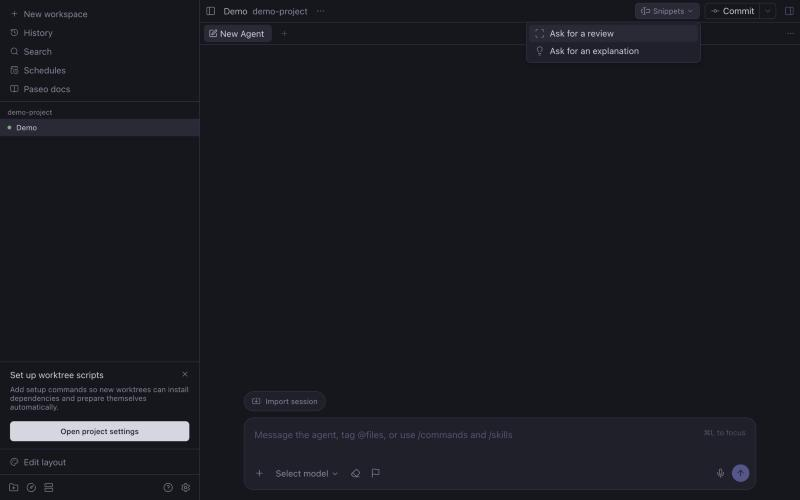

# morphise


A [Paseo](https://paseo.sh) plugin that reshapes the app from one JSON profile: theme, sidebar rows, a replacement sidebar view, workspace header buttons, composer pills and controls, slash commands, Command Center items, New workspace presets, hidden timeline rows, and an opt-in desktop style layer. Edit the profile under Settings, Plugins, Morphise; every connected app updates live.



What each section does and its limits: [OVERVIEW.md](OVERVIEW.md).

## Install

Requires Paseo 0.16.0-beta.1 or later, below 0.17.

```bash
paseo plugin install github:monarchmaisuriya/morphise --ref v0.1.0
```

## Develop

```bash
npm install
npm run typecheck
npm test
```

Versions follow [semantic versioning](https://semver.org): `package.json` holds the version, each release is tagged `vX.Y.Z`, and [CHANGELOG.md](CHANGELOG.md) lists the changes.
