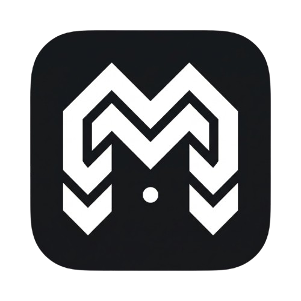

# morphise

## Quick Chat

Quick Chat is an opt-in Morphise feature for chatting and capturing ideas without choosing a project. Open it from the sidebar or Command Center, enable it, and choose a model beside New Quick Chat. The picker shows Paseo's native artwork for built-in providers, or host-supplied artwork for custom providers, directly beside the model name, with full provider identity in accessibility and hover/focus help. Duplicate model names receive a small provider-identity badge; missing icons use a neutral CPU icon. The new chat opens in Paseo's native UI. Search your existing chats by title, open one, or choose Continue in project. Stored titles wrap fully; compact rows place actions below the title. Chat info shows the full stored title, provider, archive state, UTC creation/update/archive timestamps, chat/workspace identifiers and storage locations. Missing metadata is marked Unavailable; no transcript is read for these details. Existing titles are never bulk-rewritten. Open Plugins → Morphise → Settings → Quick Chat for enable/disable, start-up, appearance and storage/privacy controls. The Quick Chat header has no redundant Settings shortcut. Active/Archived counts replace a separate chat-list heading. Refresh is right-aligned on the list filter/sort toolbar; it manually reloads the list, which is not live-subscribed. Recover handoff remains a separate chat-screen action. The last successfully used provider/model is remembered on this device by default and preloaded next time, without substituting unavailable models. Device preferences let you turn memory off, forget the saved model, choose Comfortable/Wide content, Compact/Comfortable rows and row descriptions. Reset appearance leaves model history and host availability unchanged. Each Quick Chat workspace has separate scratch storage; native tabs inside that workspace share the folder. Scratch storage is not a security sandbox.

Continue in project prepares an editable preview of visible messages for an already-open project workspace. It shows destination/provider, partial-history warnings and top-level scratch filenames. Confirming creates a new agent with ordinary project permission defaults. It does not move the original session, copy files, include reasoning/tool output/attachments, archive the source or silently switch providers. The handoff is a reviewed snapshot, not an atomic freeze: concurrent changes after the final source check are not included. Context is bounded to 40,000 UTF-16 code units including the envelope, with truncation disclosed; history reading is bounded and may be partial. Reading native history may initialize a stopped provider for history access.

Recovery records cover a completed disk write followed by a plugin/process restart; power-loss durability is not guaranteed. An interrupted creation is never automatically resent. Keep the displayed recovery ID and use Check recovery ID to look up the recorded destination. If the destination cannot be confirmed, inspect Paseo before preparing a new handoff. Disabling Quick Chat preserves chats, scratch files and minimal handoff records. Scratch and recovery data live under `PASEO_HOME/plugin-data/morphise/quick-chat` (default `~/.paseo`). No transcript bodies are stored in recovery records. There is no automatic cleanup or retention expiry; remove data manually only after preserving anything needed.

### Feature inspiration

Quick Chat lists Active and Archived conversations separately. Search titles, filter by provider, and sort by recently updated, newest created or title. Click a chat title to open it. Row icons provide file-location information, Continue in project for active chats, and Archive or Unarchive; each has an accessible name and hover tooltip.

Archive requires confirmation: it closes the agent, stops its work and Morphise commands, and removes saved command-output logs through Morphise's existing archive policy. The conversation and scratch files remain. Unarchive restores the same native agent and may initialize its provider, but does not restore removed logs or send a new prompt from Morphise. It does not archive/delete the workspace. Restore stays available for owned chats when new Quick Chats are disabled. List updates remain manual through Refresh.

New Quick Chats leave their agent title unset so Paseo applies the same first-message automatic title as normal chats. Morphise does not run a separate title model or rename existing chats. Previously created chats explicitly titled Quick Chat are not rewritten; rename those normally if needed. The workspace may retain its Quick Chat organizational label even when its agent tab has a descriptive title.

Use **Files location** on a chat row to see its exact working folder and where a relative `docs/` path resolves on the daemon host. A displayed path is not confirmation that the directory/report exists. New-chat instructions include these absolute paths and ask the agent to distinguish planned saves from completed writes; an agent response is still not a filesystem guarantee. Existing chat instructions are not retroactively changed. Scratch files remain in that folder when you continue in a project.

Morphise's Quick Chat was independently implemented. The project-free chat and later project-handoff workflow was inspired by [Quick Chat by Shuvadipta Das (@5h0ov)](https://github.com/5h0ov/paseo-quick-chat), whose source is MIT-licensed. No code, assets, tests or prompt templates from that plugin are included. Existing Morphise third-party notices remain in `NOTICE.md`.



A [Paseo](https://paseo.sh) plugin that reshapes the app from settings forms: named layouts, a status-sorted and filterable sidebar view, a kanban task board with reminders, chat notes, a prompt library, theme, sidebar rows, workspace header buttons, composer pills and controls, slash commands, Command Center items, New workspace presets, hidden timeline rows, and an opt-in desktop style layer. Change it under Settings, Plugins, Morphise; every connected app updates live.


What each section does and its limits: [OVERVIEW.md](OVERVIEW.md).

## Install

Requires Paseo 0.16.0-beta.1 or later.

```bash
paseo plugin install github:monarchmaisuriya/morphise --ref v0.23.0
```

To update from an earlier version, keeping your settings:

```bash
paseo plugin update morphise --ref v0.23.0
```

## Credits and licences

Morphise includes code ported from seven MIT-licensed Paseo plugins. Each ported file names its source in its first comment, and [NOTICE.md](NOTICE.md) holds each licence in full.

Quick Chat is separately credited above as feature inspiration, not as an eighth code port. Its independent implementation, UI refinements and device preferences add no third-party dependency. See [NOTICE.md](NOTICE.md#feature-inspiration-not-incorporated-code) for that distinction.

| Plugin | Author | What Morphise uses | Licence |
| --- | --- | --- | --- |
| [Chat Polish](https://github.com/lthieu96/paseo-chat-polish) | Hieu Le | Chat rows, merged steps, pictures, HTML pages, diagrams, the optional restyle of Paseo's own items | MIT |
| [Shell Yeah](https://github.com/stevecastaneda/paseo-plugins/tree/main/shell-yeah) | Steve Castaneda | The command runner behind `/run` and the Run buttons, and its output cards | MIT |
| [Quote](https://github.com/keefeere/paseo-quote) | Chechulin Serhii | The bar over selected text in a chat | MIT |
| [Better Paseo](https://github.com/RoundRedDot/better-paseo) | ABorakati | The Agents view, generated titles (the approach) and the matching rules of conversation search | MIT |
| [Project Groups](https://github.com/topar12/paseo-project-groups) | topar12 | "Your groups": the groups model, colours and icons, Remove project | MIT |
| [Harness Stats](https://github.com/kogekiplay/paseo-harness-stats) | kogekiplay | Session stats: the log reader and fold, the pills and the strip (with CC Switch's time-to-first-token approach) | MIT |
| [Activity](https://github.com/koinzhang/paseo-plugins/tree/main/activity) | koinzhang | The Activity tab (metrics, rankings, insights, terminals) and the Tools counts in Stats: the counting rules, read from logs instead of timelines | MIT |

Packages Morphise installs on the daemon when their option is used: [pele](https://www.npmjs.com/package/pele) (diagrams, MIT) and [sharp](https://sharp.pixelplumbing.com) (thumbnails, Apache-2.0; its prebuilt libvips is LGPL-3.0-or-later). The optional icon sets are downloaded from npm when picked: Hugeicons (MIT) and Untitled UI (its own licence). Commands that run in a terminal use the `node-pty` that Paseo itself ships (MIT); Morphise does not include a copy.

## Develop

```bash
npm install
npm run typecheck
npm test
```

Versions follow [semantic versioning](https://semver.org): `package.json` holds the version, each release is tagged `vX.Y.Z`, and [CHANGELOG.md](CHANGELOG.md) lists the changes.

### Sidebar status indicators

In Plugins → Morphise → Settings → Look → Sidebar status indicators, choose **Dot and ring** (default) or **Paseo default**. Both Paseo’s native sidebar and Morphise’s replacement sidebar use the same standalone shape, with no provider logo and no pulsing. Starting, Working, Needs input, Failed, Attention/unread and Idle/done each have a color override (`#RRGGBB`, blank follows the semantic theme default) and rotation speed: Stopped, Slow (3.2 seconds), Medium (1.6 seconds), Fast (0.8 seconds per revolution). Preview every state beside its controls. Reduced motion stops all plugin rotation.

These are profile settings, independent of Restyle Paseo, on desktop/web only. Switching to Paseo default preserves custom choices; Reset sidebar indicators restores recommended values without changing other settings. Invalid partial color text stays local and does not replace saved preferences. Existing host indicators remain intact under the presentation override, so choosing Paseo default or unloading Morphise restores them; host-owned hidden animation clocks may continue. Unknown/absent host status slots are not invented or relabeled.

Morphise’s main sidebar marks are 14px at full opacity; nested chat and subagent marks are 12px at 80% opacity, with identical state colors and rotation speeds. The old Chat row marks selector is removed; legacy saved values remain readable but no longer select dashed circles or separate dots. The replacement sidebar subscribes to the same profile preferences, including after profile hydration and when Settings is closed. On native phones the plugin retains a static dot fallback.

#### Indicator size and alignment

The same Look section includes **Main indicator size** (10–24px, default 14px) and **Indicator vertical alignment** (Top, Center or Bottom; default Center). Alignment uses the full row content, including two-line rows. Nested chats and subagents always derive exactly 80% of the main size and 80% of main opacity; there are no independent nested controls. At the default, nested size is 11.2px. Layout reset restores 14px/Center without changing colors or speeds. The full sidebar-indicator reset restores layout and state appearance together. Layout is saved separately so older readers preserve it without invalidating existing color/speed settings. Paseo default leaves native host appearance unchanged.

### Workspace checkpoints

Open a workspace's **Checkpoint** panel for Goal, Last verified result, Blocked by and Next step. Save is explicit. The card shows its revision, author and timestamp; a conflicting save is rejected without discarding your draft. Reload latest explicitly replaces that draft. This is a user/agent-authored status record, not proof that work was completed and not an automatic summary. Each field is limited to 2,000 characters.

Interactive top-level agents receive a `workspace_checkpoint` tool when their provider session opens. It reads or updates only that agent's verified own workspace; updates require the revision returned by a read. Subagents and background helpers cannot write shared checkpoint cards. Existing sessions may need to reopen to receive the tool. Other workspace Notes and titles are untouched.

### Agent work calendar

**Workbench → Calendar** offers Day/Week, date navigation, provider/workspace/project filtering and links back to chats. Times display in the viewing device's timezone. It records turn-start/end observations from when this plugin version begins observing; there is **no historical backfill** and no claim that an observation covers periods when the plugin was not running. Refresh updates the snapshot; running duration is as of that refresh.

Summed agent time includes each parallel agent separately; elapsed coverage merges overlapping intervals. Neither is human labor time or a bill. Null-ID, interrupted, overlapping/restarted observations are labelled uncertain and excluded from totals. A plugin restart cannot credit downtime: unfinished intervals become uncertain at their last recorded observation. Hidden background helpers are excluded when the host reports them; older hosts may not expose every helper flag. Terminal history older than 90 days is hidden and pruned on the next recorded event; storage caps at 20,000 intervals, preserving active records. The view discloses recording start and pruning. Agent-turn wall time can include waits for tools or user input; it is not pure CPU/model time.

Checkpoints and intervals live on the daemon in `$PASEO_HOME/plugin-data/morphise/work/records.json` (default `~/.paseo`). The store validates records, serializes one plugin process's operations, writes an atomic replacement and publishes memory only after persistence succeeds. Corrupt storage reports an error rather than overwriting it. It is not a secret store, encrypted vault or multiprocess database; only checkpoint text and visible short agent titles/IDs/timestamps are retained, not transcripts or credentials.

### Quota-aware Dispatch

Every Dispatch start/retry/keyboard launch checks the host's provider-reported quota, with a five-second timeout. Fresh, exact-provider percentage windows at **80% used or higher** show a warning and require **Continue anyway**. A reported 100% is labelled exhausted. The confirmation covers the exact model, source/project parameters and prompt batch, expires after at most a minute and is invalidated by changes. Cancel or leaving Dispatch during preflight starts nothing.

Quota is advisory provider-level data, not a guarantee of the account a future session will use or enough capacity for a task. Undated, over-five-minute-old, malformed, unsupported or failed reports show Unavailable and do not block your explicit launch. There is no credential-file read, new provider login, task-cost forecast, automatic account/model substitution or batch resizing. Provider usage lookups use Paseo's existing authenticated host API.

### Workflow clarity and safe editing

Checkpoint drafts are kept by workspace while navigating within the same plugin client session, together with the baseline revision. Save is explicit; status shows Unsaved/Saving/Saved. Dirty Reload and save conflicts show Your draft alongside Latest saved. **Keep my draft** explicitly rebases for the next save; **Use latest and discard draft** explicitly replaces it. An older in-flight save cannot clear a newer navigation draft. Reloading/quitting the plugin client ends session-only protection: save to persist on the host. Draft text is not copied into browser storage.

Calendar groups intervals by local day and splits cross-midnight durations at each boundary. Last refreshed identifies the snapshot time; counts do not advance merely because a filter redraws. Old-range data is hidden while fetching. Empty states distinguish filters with no matches, a range before recording began, no recorded work and errors. Coverage details disclose recording start, pruning and uncertain intervals; a local-day section is not evidence that observation was continuous.

Dispatch shows a selection-time provider quota summary before Start and still performs mandatory preflight at launch. Checking/unavailable remain explicit. High-usage confirmations show the exact immutable model, project/source, destination, mode and selected prompts. Changing choices removes the stale confirmation. The newest preflight replaces older preview data; no model/account change is automatic.

Plugin Settings includes **Search settings** and a topic search/scope summary above existing pages. This searches a curated page/topic directory, not arbitrary current control text, saved values or secrets. Results open the existing settings page and preserve the layout/draft being edited. Mixed-scope pages say so; individual controls retain their existing device/host/profile semantics. Quick Chat includes the same directory.

Morphise sidebar status marks expose one consistent state/reason/time explanation on hover and in accessible labels. Workspace time uses host statusEnteredAt unless a manual mark is in effect. Agent snapshots without a genuine state-entry timestamp say Time in state unavailable; last activity is not substituted. Generic reasons explain the state when no concrete error/permission detail is available. Native host indicators are not relabeled by this feature; touch clients retain the accessibility text rather than a hover interaction.
